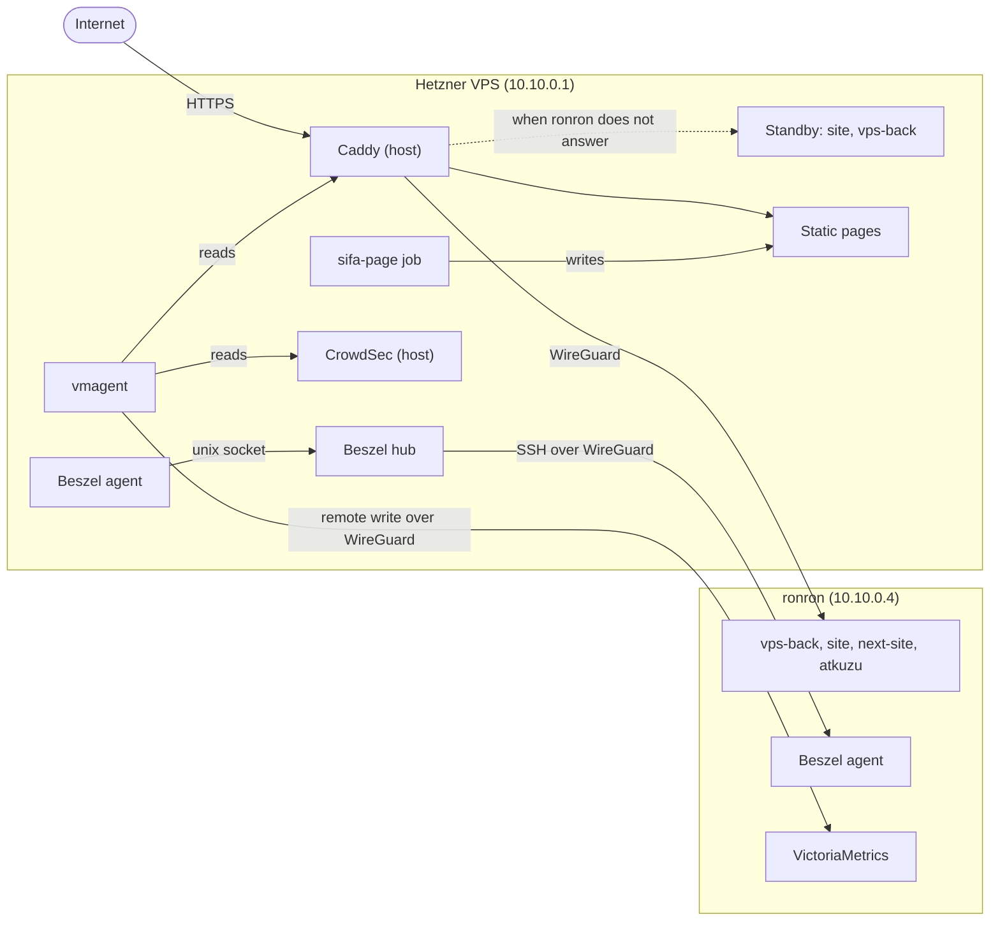

# hetzner-docker

The Docker Compose stack of my Hetzner VPS (arm64). The VPS is the public entry of my servers: Caddy runs on the host and serves my public sites. The apps behind these sites run on ronron, my home server, and Caddy reaches them over WireGuard ([ronron-docker](https://git.tomplanche.com/tom/ronron-docker)). My site and my API also have a standby copy on the VPS: when ronron does not answer, Caddy sends their requests to this copy.

This repository shows my setup. It is not a template: it depends on my servers, my domains and files that are not in git.

## Architecture

## Public sites

| Site | Target |
|------|--------|
| `tomplanche.com` | [site](https://github.com/TomPlanche/portfolio-v222) on ronron, with a standby on the VPS. `/api/` goes to vps-back. `/sifa-page/` and `/dither/` are static pages of the VPS. |
| `next.tomplanche.com` | [next-site](https://github.com/TomPlanche/portfolio-v222) on ronron: the `next` branch of the portfolio. |
| `api.tomplanche.com` | [vps-back](https://github.com/TomPlanche/vps-back) on ronron, with a standby on the VPS: my API (Rust, axum). |
| `atkuzu.tomplanche.com` | [atkuzu](https://tangled.org/tomplanche.com/atkuzu) on ronron: a Takuzu game with a daily puzzle. |

## Services on the VPS

| Service | Role |
|---------|------|
| [Caddy](https://caddyserver.com) | Runs on the host, not in Docker. It serves the sites, with automatic HTTPS. |
| site, vps-back | The standby copies of my site and my API. They run the same commits as ronron, and they get requests only when ronron does not answer. |
| [sifa-page](https://github.com/singi-labs/sifa-page) | A job that builds a static page from a sifa.id profile, into `/var/www/sifa-page`. |
| [Beszel](https://beszel.dev) hub | The resource dashboard of my servers: CPU, RAM, disk, network and containers, with history and alerts. |
| Beszel agent | Sends the stats of the VPS to the hub. |
| [vmagent](https://docs.victoriametrics.com/vmagent/) | Reads the metrics of Caddy and CrowdSec every 30 seconds, and sends them to VictoriaMetrics on ronron. |

The other apps of the sites (next-site, atkuzu) moved to ronron. `compose.yaml` still holds their services, stopped, until the move is complete.

## Design

### Network

- The containers listen on `127.0.0.1` only. Caddy on the host is the only way in.
- The Beszel agent of the VPS listens on a unix socket, not on a network port.
- Caddy reaches ronron over WireGuard (`wg0`). The VPS has the address `10.10.0.1`, and ronron has `10.10.0.4`.

### Images

- A local machine builds and tests the images, then sends them to the VPS over SSH. The VPS needs no compiler and no source code.
- The local machine and the VPS must have the same architecture (arm64), else the containers do not start.
- Before each deploy, `just ship` tags the current image as `<image>-previous`. A rollback is one `docker tag`.
- `just standby` builds the standby copies from the commits that run on ronron, then copies the static files of vps-back and the fonts of the site from ronron.

### Caddy

- This repository owns only the sites of `caddy/`. `just caddy` installs them in `/etc/caddy/managed/` and touches nothing else. The main Caddyfile and the other sites of the host come from a private repository.
- Before each install, `just caddy-diff` compares the routes that Caddy runs (from its admin API) with the new routes.
- For the site and the API, Caddy has two upstreams: ronron first, then the standby on the VPS (`caddy/_failover.caddy`). It checks both every 10 seconds. When ronron does not answer, the requests go to the standby, and they go back to ronron when it answers again. A request that was in progress when ronron went off goes to the standby after 10 seconds at most, except a POST, which Caddy never sends twice.
- When an app does not answer, for example during a restart, Caddy answers a short 503 page with `Retry-After`, not an empty 502. For the site and the API, this happens only when the standby does not answer either.

### Monitoring

- The Beszel hub watches the VPS and ronron. It listens on `127.0.0.1` only: `just beszel-tunnel` opens it through an SSH tunnel.
- vmagent adds the label `machine="hetzner"` to each metric. If ronron does not answer, vmagent keeps the metrics on its disk (1 GB at most) and sends them later. Grafana on ronron shows them.

### Local test

`compose.local.yaml` changes the stack for a local machine: test env files, the apps in local containers, a Caddy container on `localhost:8080`, and a local VictoriaMetrics. `just local-test` sends its checks through the local Caddy, with the routes of production.

## Layout

| Path | Content |
|------|---------|
| `compose.yaml` | The production stack. |
| `compose.local.yaml` | The changes for the local test. |
| `justfile` | All the commands. `just` lists them. |
| `images/` | One Dockerfile for each image that this repository builds. |
| `caddy/` | The Caddy sites of this stack. `_failover.caddy` is the proxy with a standby, which the sites import. |
| `local/Caddyfile` | The Caddy of the local test. |
| `vmagent/scrape.yaml` | The targets of vmagent. |
| `scripts/beszel-setup.sh` | Connects the Beszel agent to its hub. |
| `env/*.env.example` | The keys of each env file. The real env files are not in git. |

`data/` (the files mounted into the containers) and `src/` (the sources of the images) are not in git.

## Related repositories

- [ronron-docker](https://git.tomplanche.com/tom/ronron-docker): the stack of ronron, with the apps, Immich, Forgejo, VictoriaMetrics and Grafana.
- [vps-back](https://github.com/TomPlanche/vps-back), [portfolio-v222](https://github.com/TomPlanche/portfolio-v222), [atkuzu](https://tangled.org/tomplanche.com/atkuzu), [sifa-page](https://github.com/singi-labs/sifa-page): the sources of the images.
